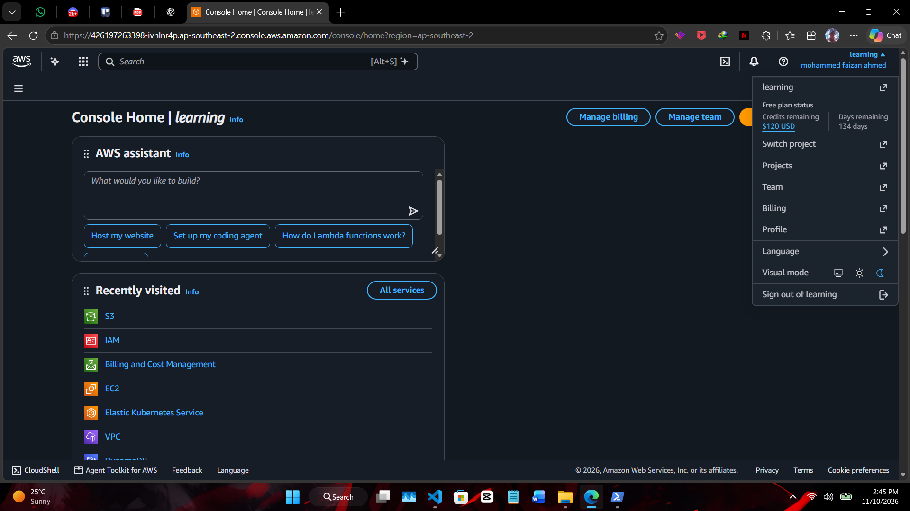
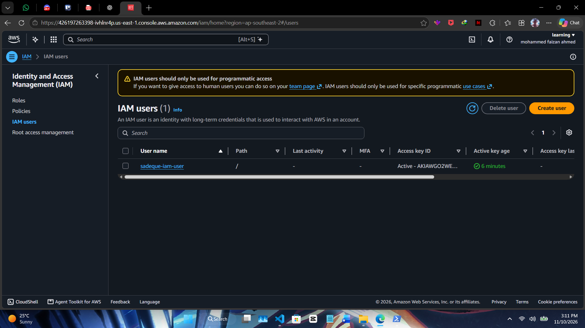
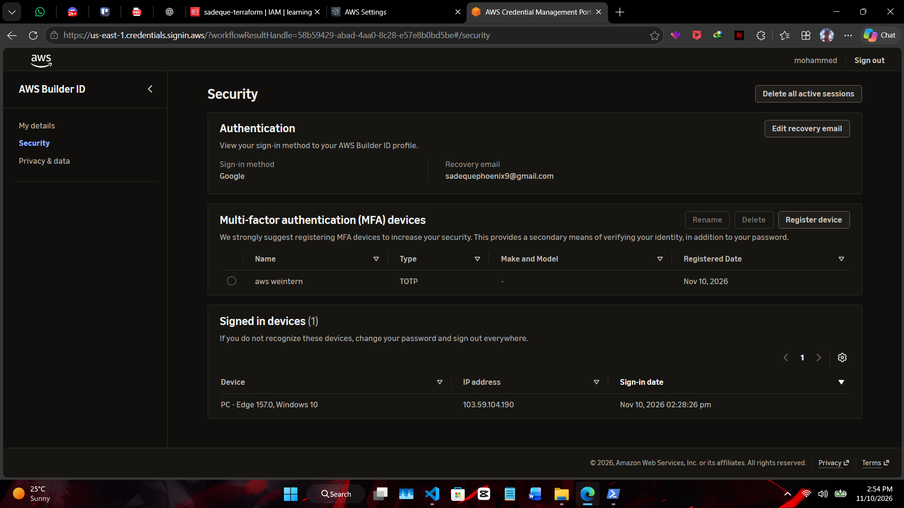
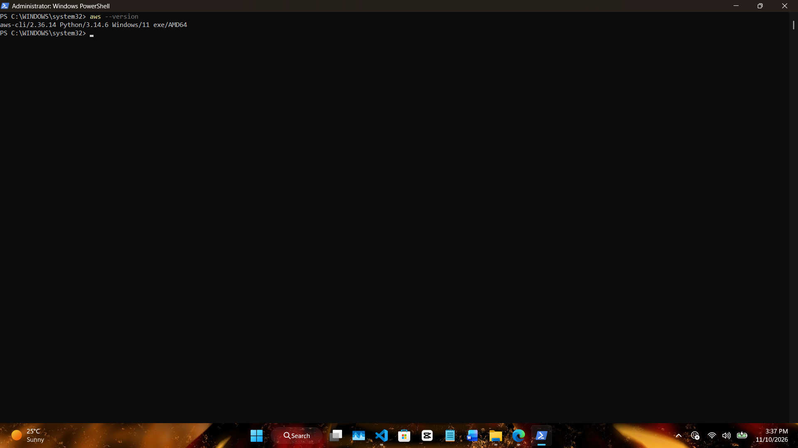
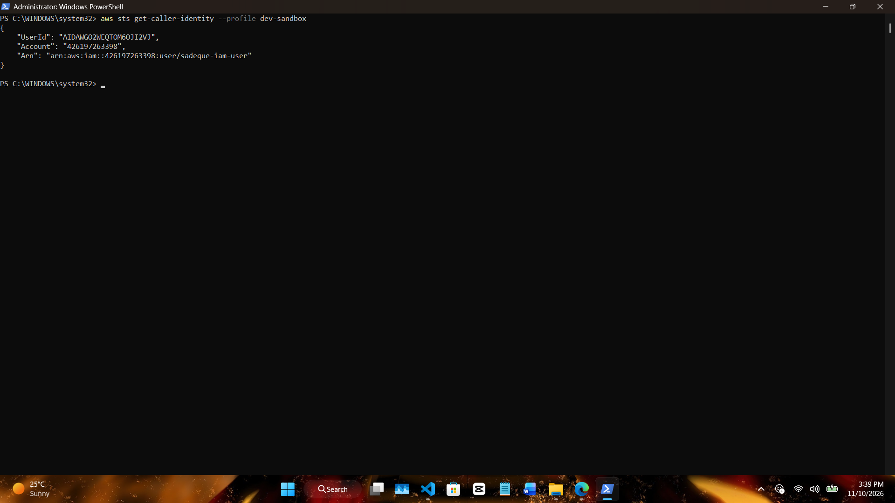

# AWS Environment Setup and Infrastructure Documentation

This repository documents the AWS environment onboarding activities and the infrastructure map prepared during the setup task.

## Table of Contents

- [1. Cloud Account Onboarding](#1-cloud-account-onboarding)
  - [1.1 AWS Console Access](#11-aws-console-access)
  - [1.2 IAM User](#12-iam-user)
  - [1.3 Multi-Factor Authentication (MFA)](#13-multi-factor-authentication-mfa)
  - [1.4 AWS CLI Setup and Authentication](#14-aws-cli-setup-and-authentication)
  - [1.5 Dev Sandbox Verification](#15-dev-sandbox-verification)
  - [1.6 Naming and Tagging Conventions](#16-naming-and-tagging-conventions)
  - [1.7 Pending Checks](#17-pending-checks)
- [2. Infrastructure Map](#2-infrastructure-map)
  - [2.1 Network Overview](#21-network-overview)
  - [2.2 Key AWS Services](#22-key-aws-services)
  - [2.3 Security Design](#23-security-design)
- [3. Repository Structure](#3-repository-structure)

---

## 1. Cloud Account Onboarding

### 1.1 AWS Console Access

- Signed in to the AWS Management Console.
- The console screenshot shows the `ap-southeast-2` (Asia Pacific – Sydney) region.
- The console displays the project label `learning`.
- The AWS account ID must be compared with the official Dev Sandbox account ID shared by the mentor. A successful login alone does not prove that the correct sandbox account is being used.

**Evidence:**



### 1.2 IAM User

The provided screenshot shows the IAM Users page and an IAM user entry in the AWS account.

**Evidence:**



### 1.3 Multi-Factor Authentication (MFA)

The AWS Builder ID Security page shows a registered TOTP MFA device named `aws weintern`, with a registration date of November 10, 2026.

> **Important:** AWS Builder ID is separate from an IAM user and the AWS account root user. This screenshot confirms MFA registration for the Builder ID only. It does not prove that MFA is enabled for the IAM user, root user, or credentials used by the AWS CLI.

**Evidence:**



### 1.4 AWS CLI Setup and Authentication

AWS CLI is installed on Windows. The terminal evidence includes the CLI version output and an AWS STS caller identity check using the `dev-sandbox` profile.

Useful verification commands:

```bash
aws --version
aws configure list --profile dev-sandbox
aws sts get-caller-identity --profile dev-sandbox
```

The `get-caller-identity` command helps verify which AWS identity and account the selected profile is using.

**Evidence:**





### 1.5 Dev Sandbox Verification

A CLI identity check was run with the `dev-sandbox` profile. The returned account and ARN should be compared with the official sandbox details supplied by the mentor.

**Status:** CLI identity output is available; final confirmation that this is the approved Dev Sandbox account remains subject to mentor verification.

### 1.6 Naming and Tagging Conventions

The onboarding report records a review of the team's resource naming and tagging practices. The review areas were:

| Area | Items reviewed | Purpose |
|---|---|---|
| Resource naming | EC2 instances, S3 buckets, VPCs, RDS databases, load balancers | Consistent resource identification |
| Environment naming | Dev, Test, Staging, Production | Distinguish resources by environment |
| Resource tags | Owner, Project, Environment, CostCenter, ManagedBy | Ownership, organization, and cost tracking |
| Naming rules | Capitalization, separators, length limits, approved values | Maintain consistent naming |

**Note:** The official team naming and tagging standards document was not included in the supplied evidence. Confirm the exact required formats and mandatory tags with the mentor before applying them to resources.

### 1.7 Pending Checks

- [ ] Confirm the AWS account ID with the mentor's official Dev Sandbox account details.
- [ ] Confirm MFA is enabled for the required IAM and/or root identities, not only AWS Builder ID.
- [ ] Confirm the `dev-sandbox` CLI profile uses the approved credentials and account.
- [ ] Obtain and follow the team's official naming and tagging standards.
- [ ] Request mentor review and sign-off.

---

## 2. Infrastructure Map

The AWS infrastructure diagram was created in Lucidchart.

**[Open the AWS Infrastructure Map in Lucidchart](https://lucid.app/lucidchart/1b46ef8c-afe4-4eed-952d-bb7a901fd1cb/edit?viewport_loc=-156%2C-3569%2C6053%2C3203%2C0_0&invitationId=inv_8b44be66-992d-4bce-a66d-2ae06521c3cc)**

### 2.1 Network Overview

The diagram represents an AWS environment with the following layout:

- **VPC CIDR:** `10.0.0.0/16`
- **Region shown in the architecture:** `ap-south-2`
- **Availability Zones:** `ap-south-2a` and `ap-south-2b`
- **Subnet tiers in each Availability Zone:**
  - Public subnet
  - Private application subnet
  - Private database subnet

This separation is intended to provide controlled internet ingress, private application processing, and restricted database access.

**Architecture diagram:**


### 2.2 Key AWS Services

| AWS service/component | Role in the architecture | Important checks |
|---|---|---|
| Internet Gateway (IGW) | Provides internet connectivity for eligible public resources. | Confirm it is attached to the VPC and public route tables have the intended default route. |
| Public route tables | Control routing for public subnets. | Confirm subnet associations and the `0.0.0.0/0` route target. |
| NAT Gateway | Allows private-subnet resources to initiate outbound internet connections. | Confirm NAT Gateway placement and private route-table targets; check whether a second NAT Gateway is required in the other AZ. |
| Application Load Balancer (ALB) | Receives HTTP/HTTPS requests and routes them to healthy targets. | Verify listeners, certificates, target groups, health checks, scheme, and subnet mapping. |
| Network Load Balancer (NLB) | Provides Layer 4 load balancing for TCP, TLS, or UDP traffic. | Confirm its purpose and whether it is actively used. |
| Amazon EC2 | Runs application workloads in private application subnets. | Verify instance IDs, private IPs, launch templates, target-group registration, and Security Groups. |
| Amazon RDS | Provides the managed relational database service in private database subnets. | Verify engine, endpoint, port, DB subnet group, encryption, backups, and Multi-AZ status. |
| VPC Endpoints | Provide private connectivity from the VPC to supported AWS services. | Identify endpoint type, service name, route-table/subnet associations, Security Groups, and policy. |
| Security Groups | Act as stateful virtual firewalls for resources. | Confirm only required sources and ports are allowed; restrict database ingress to the application tier. |
| Network ACLs | Act as stateless subnet-level traffic filters. | Review inbound/outbound rules and required ephemeral return ports. |
| Amazon S3 | Stores objects; the diagram labels an S3 bucket for CloudTrail logs. | Verify bucket policy, encryption, versioning, lifecycle, and Block Public Access settings. |
| AWS CloudTrail | Records supported AWS account and API activity for auditing. | Verify trail scope, event selection, log destination, and delivery status. |

### 2.3 Security Design

The architecture uses multiple layers of network controls:

- **Security Groups:** Stateful controls attached to resources such as EC2, load balancers, and RDS.
- **Network ACLs:** Stateless traffic filters applied at the subnet boundary.
- **Route tables:** Define the network paths available to resources.
- **Subnet separation:** Public, private application, and private database tiers reduce direct exposure of internal workloads.

| Traffic path | Intended security control |
|---|---|
| Internet → ALB | Allow only required listener protocols and ports, commonly HTTPS and optionally HTTP for redirect. |
| ALB → EC2 targets | Allow the application target port from the ALB Security Group. |
| EC2 → RDS | Allow the database port only from the application Security Group. |
| Internet → private EC2/RDS | Do not allow direct inbound internet access. |
| Private EC2 → Internet | Permit outbound access through NAT only where required by routing and Security Group policy. |
| Workloads → AWS services | Use approved VPC Endpoints and endpoint policies where appropriate. |
| CloudTrail → S3 | Restrict bucket writes to the configured CloudTrail service/trail and authorized administrators. |

> **Validation note:** This is a documentation-level view of the architecture. Confirm actual route tables, subnet associations, listeners, Security Group rules, NACL rules, endpoint policies, and service configurations in the AWS account before treating the diagram as a verified live-state design.

---

## 3. Repository Structure

```text
aws-environment-setup/
├── README.md
└── screenshots/
    ├── aws-console.png   # AWS Console home
    ├── iam-user.png   # IAM Users page
    ├── mfa.png   # AWS Builder ID MFA
    ├── awscli-version.png   # AWS CLI version
    ├── dev-sendbox-verify.png   # AWS STS caller identity
    └── infra-diagram.png   # AWS infrastructure diagram
```

## Notes

- Screenshots are stored in the `screenshots/` directory and embedded using relative Markdown image paths.
- Do not commit access keys, secret keys, passwords, MFA recovery codes, or other credentials.
- Review account identifiers and other environment details before publishing this repository publicly.
